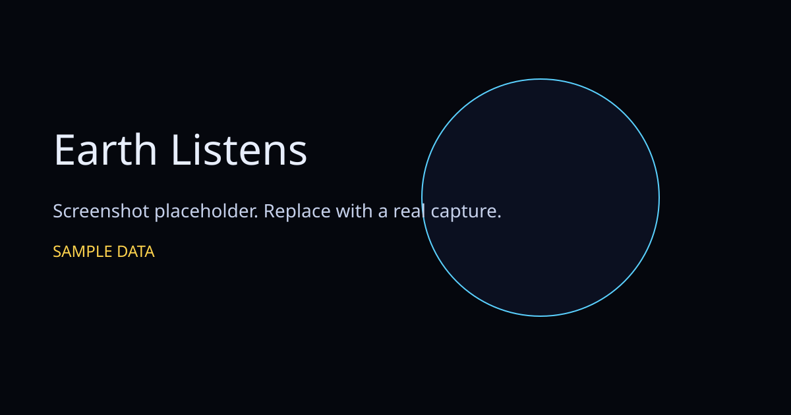
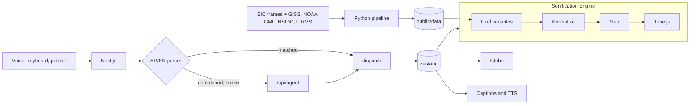

# Earth Listens

Earth Listens is a voice-first jukebox for NASA Earth data. It turns temperature, carbon dioxide, Arctic sea ice, and wildfire detections into a deterministic score: higher means more, louder means stronger, a faster rhythm means faster change, and the sound sits where the measurement sits on the planet. It is built for blind and low-vision listeners, in English and Egyptian Arabic, with a globe for everyone else. The sound is never generated by a model. A model may only parse a command or speak a caption.



NASA Space Apps Cairo runs 13–14 November 2026. The submission deadline is to be confirmed with Space Apps Cairo.

Files named `*.sample.json`, and frames flagged `"sample": true`, are **SAMPLE** data from a seeded formula. They are not measurements. Layers whose registry file is not a sample file are decoded from the cited source. A single-day or single-month map is not an annual mean.

## Quick start

Node 24 and pnpm 12.18.0:

```bash
corepack enable
pnpm i
pnpm dev
```

Open [http://localhost:3000/en?demo=1](http://localhost:3000/en?demo=1). Arabic is `/ar?demo=1`. Demo mode preloads the catalog, the frames, the globe texture, the font files, and the synthesis chunks, then runs with no network and no API keys.

## Environment

Copy `.env.example` to `.env.local` if you want a provider. Leave the values blank to keep the mock agent. Never commit a real key, and never put a key in a `NEXT_PUBLIC_` variable.

| Name                                                                      | Used by                                         |
| ------------------------------------------------------------------------- | ----------------------------------------------- |
| `GROQ_API_KEY`, `GEMINI_API_KEY`, `OPENROUTER_API_KEY`                    | `/api/agent` only                               |
| `AGENT_PROVIDER_ORDER`                                                    | which of those three to try                     |
| `GROQ_AGENT_MODEL`, `GEMINI_AGENT_MODEL`, `OPENROUTER_AGENT_MODEL`        | model ids                                       |
| `GROQ_STT_MODEL`                                                          | `/api/stt`                                      |
| `FIRMS_MAP_KEY`                                                           | FIRMS area history, server only                 |
| `OPENAQ_API_KEY`                                                          | OpenAQ stations, server only                    |
| `R2_ACCESS_KEY_ID`, `R2_SECRET_ACCESS_KEY`, `R2_S3_ENDPOINT`, `R2_BUCKET` | `scripts/upload-r2.mjs`                         |
| `NEXT_PUBLIC_ASSET_BASE_URL`                                              | public base for R2 objects; `off` uses 2K files |

## Scripts

| Script                              | What it does                          |
| ----------------------------------- | ------------------------------------- |
| `pnpm dev`                          | Next.js dev server                    |
| `pnpm build` / `pnpm start`         | production build and server           |
| `pnpm typecheck`                    | `tsc --noEmit`                        |
| `pnpm lint`                         | ESLint                                |
| `pnpm format` / `pnpm format:check` | Prettier                              |
| `pnpm test`                         | Vitest with coverage                  |
| `pnpm test:e2e`                     | Playwright, axe, and the offline demo |
| `pnpm lhci`                         | Lighthouse CI                         |
| `pnpm data:samples`                 | regenerate SAMPLE json and frames     |
| `pnpm data:explanations`            | template explanations                 |
| `pnpm data:quiz`                    | recompute quiz truth                  |
| `pnpm data:schemas`                 | zod to JSON Schema                    |
| `pnpm data:validate`                | validate `public/data`                |
| `pnpm py:test`                      | pipeline pytest                       |

## Assets and live data

2K WebP/PNG derivatives are in the repo. 4K/8K files belong in the GitHub release `data-v1` and are served from Cloudflare R2. Nothing in this repo uploads them.

Hassan sets these GitHub Actions secrets (values only, never committed): `R2_ACCOUNT_ID`, `R2_ACCESS_KEY_ID`, `R2_SECRET_ACCESS_KEY`, `R2_BUCKET`, and optionally `FIRMS_MAP_KEY` and `OPENAQ_API_KEY`.

Vercel env (server): the same names, plus `CRON_SECRET`. `NEXT_PUBLIC_ASSET_BASE_URL` may be set to the R2 public URL. Leave it unset to use `https://pub-f4844155e9804bb5adcb0c121896e82b.r2.dev`. Set it to `off` to stay on the committed 2K files.

```bash
# Create the release yourself, then mirror it. Dry-run prints the file list.
gh release create data-v1 --title "Earth Listens data v1" --notes "Derived textures and frames."
gh release upload data-v1 path/to/file.ktx2
node scripts/upload-r2.mjs --dir release-assets
node scripts/upload-r2.mjs --dir release-assets --yes
```

Or run the **sync-r2** workflow (`workflow_dispatch`, input `tag=data-v1`). Snapshots refresh every 3 hours via the **snapshot** workflow. Vercel cron hits `/api/cron/snapshot` once a day and requires `Authorization: Bearer $CRON_SECRET`.

## Architecture



| Module            | Path                                       |
| ----------------- | ------------------------------------------ |
| Actions and store | `src/core`                                 |
| Data contracts    | `src/modules/data`                         |
| Sonification      | `src/modules/sonification`                 |
| Parser and agent  | `src/modules/agent`                        |
| Speech            | `src/modules/voice`                        |
| Narration         | `src/modules/narration`                    |
| Quiz and tutorial | `src/modules/quiz`, `src/modules/tutorial` |
| Shortcuts         | `src/modules/a11y`                         |
| Pipeline          | `pipeline/`                                |

The longer map is `docs/ARCHITECTURE.md`.

## Earth Sonification Language

| Question   | Mapping                                                                                 |
| ---------- | --------------------------------------------------------------------------------------- |
| How much   | MIDI register, then Hz = `440 * 2^((midi-69)/12)`, quantized to the scale               |
| How strong | `-30 + 24*n` dB, then voice-count and a ceiling of `-6 dB`                              |
| How fast   | ticks `1+floor(3*r+0.5)`, tempo `60+120*r`                                              |
| Where      | HRTF position from latitude and longitude, pan = x                                      |
| What       | temperature warm-lead, wildfire crackle-marimba, sea ice glass-bells, CO2 beating-drone |

The formulas, registers, and the sample CO2 checks are in `docs/SONIFICATION.md`.

## Where real data plugs in

Summary of `docs/DATA_MAPPING_GUIDE.md`:

1. `python -m earth_pipeline.fetch --layer <id>` writes `pipeline/raw/` and a manifest. Use `--dry-run` first.
2. `python -m earth_pipeline.build --layer <id>` parses, cleans, and aggregates.
3. Review the printed range, then edit `public/data/layers/<id>.config.json` (`LayerConfigSchema`).
4. Export `public/data/layers/<id>.json` with `sample: false`, `retrieved`, and `sha256` (`LayerDataSchema`).
5. Point `public/data/registry.json` at that file (`RegistrySchema`).
6. `pnpm data:validate && pnpm test`. Update the score snapshot only on purpose.
7. Put frames in `public/frames/<id>/<t>.webp`.
8. `python -m earth_pipeline.validate` and commit `docs/validation/`.
9. `pnpm data:quiz` and `pnpm data:explanations`.
10. Add narration MP3s and mark them `recorded` in `public/audio/narration/manifest.json`.

## Accessibility

WCAG 2.2 AA. Skip link, landmarks, bilingual captions, and one polite live region.

| Keys              | Action                           |
| ----------------- | -------------------------------- |
| Alt+Shift+T       | Talk                             |
| Alt+Shift+S       | Stop                             |
| ?                 | Help                             |
| /                 | Command box                      |
| Escape            | Skip the intro or close a dialog |
| 1 / 2 / 3         | Quiz answers, only in the quiz   |
| PageDown / PageUp | Story chapters                   |
| Arrows, Home      | Globe, when it is focused        |

Details are in `docs/ACCESSIBILITY.md`.

## Branches

`develop` is the integration branch. This base is `feat/base-mvp`, opened against `develop`. Owner branches are cut from the tag `base-phase-a`:

| Branch                     | Who                               |
| -------------------------- | --------------------------------- |
| `feat/sonification-engine` | Hassan                            |
| `feat/data-pipeline`       | Hassan, Basmala checks sources    |
| `feat/agent-voice`         | Hassan                            |
| `feat/globe-3d`            | Zain Eldin                        |
| `feat/intro-landing`       | Zain Eldin and Nesma Nassar       |
| `feat/frontend-a11y`       | Youssef Alnaggar                  |
| `feat/tutorial-quiz`       | Youssef Alnaggar and Basmala Samy |
| `docs/story-research`      | Nesma Nassar and Basmala Samy     |

Hassan merges into `develop` with a merge commit. Only Hassan merges `develop` into `main`. Protect both branches with a pull request, green CI, and one review, and block force-pushes. Do not change those settings from a pull request.

## Attribution

Uses NASA data; not endorsed by NASA.

We acknowledge the use of data and imagery from LANCE FIRMS operated by NASA's Earth Science Data and Information System (ESDIS) with funding provided by NASA Headquarters.

Also credit GISTEMP v4 (NASA GISS), NOAA GML Mauna Loa (Lan, Tans, and Thoning), NSIDC Sea Ice Index v4 (Fetterer et al.; verify the DOI before citing it), NASA SVS 5113, and GIBS. The day texture is Blue Marble Next Generation from GIBS. Full wording is in `ATTRIBUTION.md`.

## Team

| Person                    | Role                                     |
| ------------------------- | ---------------------------------------- |
| Hassan (`HassenTMLCSSJS`) | sonification, data, agent, merges        |
| Zain Eldin                | globe and intro visuals                  |
| Nesma Nassar              | story copy                               |
| Youssef Alnaggar          | interface, accessibility, tutorial, quiz |
| Basmala Samy              | research, sources, quiz clips            |

## License

MIT. Copyright (c) 2026 Team Ctrl+Earth. See `LICENSE`.
