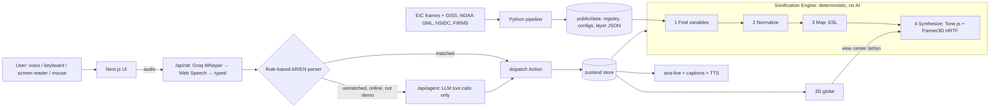

# Architecture

Earth Listens turns a NASA Earth Information Center picture into a deterministic score. Voice, the keyboard, a screen reader, and the pointer all call `dispatch(action)`. Nothing else changes application state.

Sound is never generated by a model. A model may only parse an unmatched command into a tool call, or speak a caption that the engine already computed.

## Where the code lives

| Path                       | Role                                                                 |
| -------------------------- | -------------------------------------------------------------------- |
| `src/core/actions.ts`      | `Action` union and zod schemas                                       |
| `src/core/store.ts`        | zustand state and `dispatch`                                         |
| `src/core/bus.ts`          | tutorial and quiz listeners                                          |
| `src/core/catalog.ts`      | loads the registry and turns frames into blob URLs                   |
| `src/core/csp.ts`          | Content-Security-Policy strings                                      |
| `src/proxy.ts`             | next-intl locale routing, the demo cookie, and the stricter demo CSP |
| `src/modules/data`         | zod contracts, loader, regions, series helpers                       |
| `src/modules/sonification` | pure ESL math, score builder, Tone.js player, earcons                |
| `src/modules/agent`        | Arabic/English parser and the provider chain                         |
| `src/modules/voice`        | speech-to-text and text-to-speech engines                            |
| `src/modules/narration`    | scripts, announcer, captions                                         |
| `src/modules/quiz`         | ground truth and the local CSV log                                   |
| `src/modules/tutorial`     | the seven guided steps                                               |
| `src/modules/a11y`         | shortcut table                                                       |
| `src/components`           | the globe, the intro, the jukebox, and the pages                     |
| `pipeline/`                | offline Python fetch, clean, aggregate, export, validate             |

Import a module only through `src/modules/<name>/index.ts`. ESLint rejects `@/modules/<name>/<file>`.

## Demo mode

`?demo=1` sets the `el.demo` cookie. The catalog preload copies the JSON files, the latest frame of each layer, and the globe texture into memory. The shell requests the voice chunk during that load. On a demo page it also warms the Tone.js chunk inside a module worker. The globe’s Three.js chunk loads after a pointer, focus, or playback. After `networkidle`, the listen page plays, compares, opens the quiz, and runs the symphony with no further network. Kokoro and Piper are not called in demo mode. There is no `/api` call.

Sample files are synthetic. The banner reads `SAMPLE DATA: not real measurements` and `بيانات تجريبية: ليست قياسات حقيقية`.
